# Guía Paso a Paso: Modelo de Información y Diagrama de Contexto

Esta guía complementa el `README.md` del taller. Cubre los dos entregables de la Parte 1 y la Parte 2: el **modelo entidad-relación (ERD)** y el **diagrama de contexto de negocio**, ambos construidos sobre el caso base de la Clínica Salud Viva.

---

## Parte A — Modelo Entidad-Relación (ERD)

### A.1 Leyenda de notación ERD

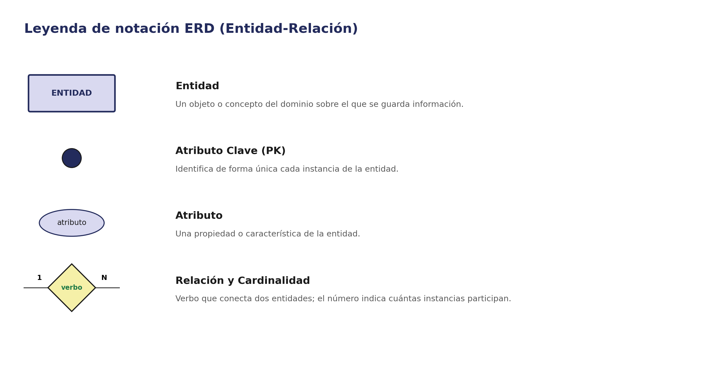

### A.2 Metodología en 4 pasos

1. **Identificar entidades** — liste los sustantivos clave del dominio sobre los que necesita guardar información.
2. **Definir atributos** — para cada entidad, anote sus propiedades y marque cuál es la clave primaria (PK).
3. **Trazar relaciones** — conecte las entidades que se relacionan entre sí y nombre cada relación con un verbo.
4. **Asignar cardinalidad** — indique cuántas instancias participan a cada lado de la relación (1:1, 1:N, N:N).

### A.3 Ejemplo guiado: Paciente, Cita, Médico, Especialidad y Factura

#### Paso 1 — Identificar entidades

Del caso base se extraen cinco entidades: **Paciente**, **Cita**, **Médico**, **Especialidad** y **Factura**. Cada una representa un concepto sobre el que la clínica necesita guardar datos.

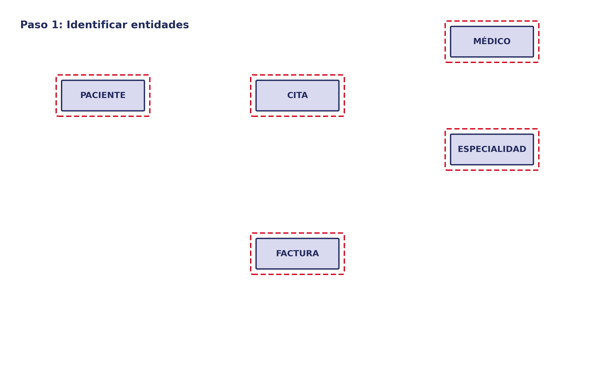

#### Paso 2 — Definir atributos

Se agrega a cada entidad su atributo clave (círculo oscuro) y sus atributos descriptivos. Por ejemplo, `CodPaciente` identifica de forma única a cada paciente; `Nombre` es solo descriptivo.

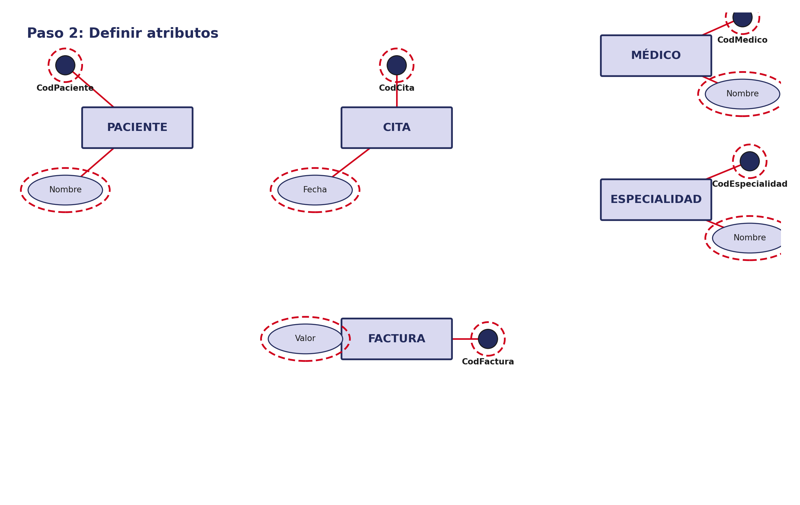

#### Paso 3 — Trazar relaciones

Se conectan las entidades relacionadas y se nombra cada relación con un verbo: el paciente **agenda** una cita, la cita es **con** un médico, es **de** una especialidad y **genera** una factura. En este paso aún no se define cuántas instancias participan.

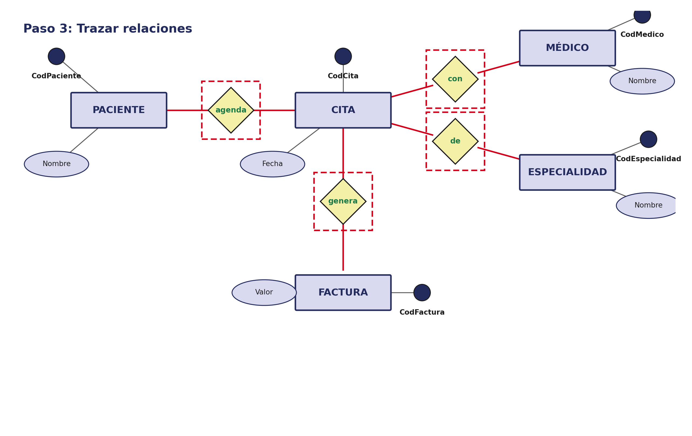

#### Paso 4 — Asignar cardinalidad

Se etiqueta cada extremo de cada relación. Un paciente puede agendar muchas citas (1:N), pero cada cita es con un solo médico (N:1) y de una sola especialidad (N:1), y genera exactamente una factura (1:1).

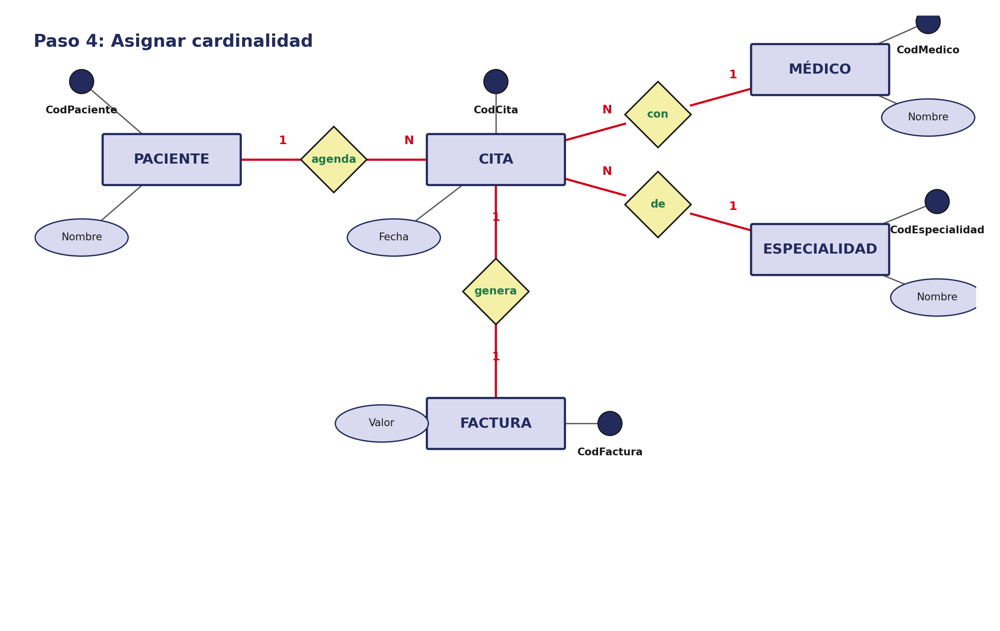

### A.4 Errores comunes en el ERD

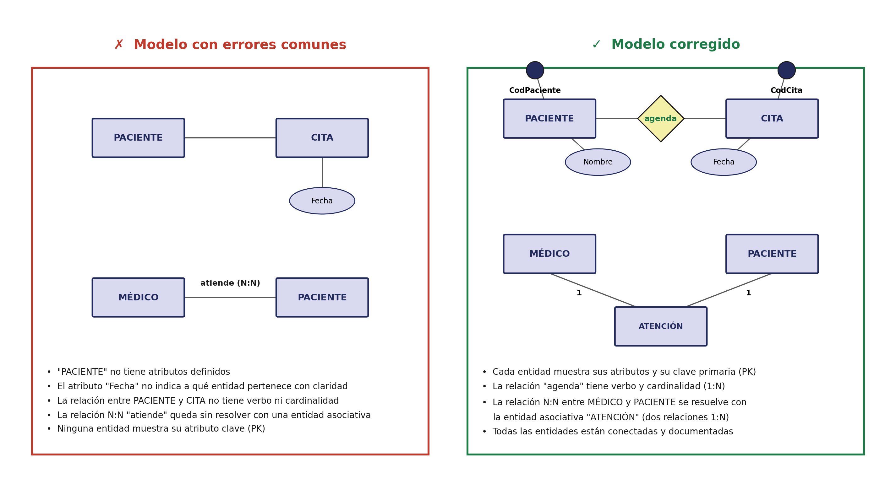

> Explore este ERD de forma interactiva (clic por entidad) en [`visualizacion-modelo-informacion.html`](visualizacion-modelo-informacion.html).

---

## Parte B — Diagrama de Contexto de Negocio

### B.1 Leyenda de notación

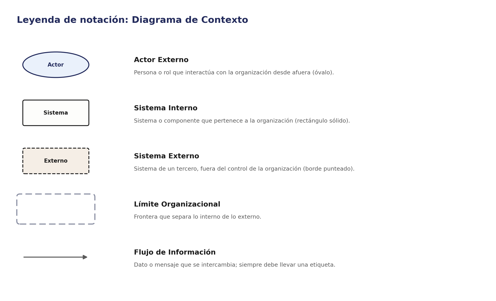

### B.2 Metodología en 4 pasos

1. **Identificar actores externos** — ¿quién interactúa con la organización desde afuera? Incluya también los sistemas de terceros con los que se intercambia información.
2. **Identificar sistemas internos** — trace el límite organizacional y ubique dentro los sistemas propios que participan en el proceso.
3. **Trazar flujos de información** — conecte actores y sistemas según quién envía información a quién.
4. **Etiquetar flujos y validar** — indique qué información viaja por cada flujo y confirme que ningún actor o sistema quede sin conexión.

### B.3 Ejemplo guiado: contexto de la Clínica Salud Viva

#### Paso 1 — Identificar actores externos

Se identifican el **Paciente**, el **Médico** y el **Asistente Administrativo** como actores que interactúan con la clínica, y la **Aseguradora** como sistema externo (no pertenece a la organización).

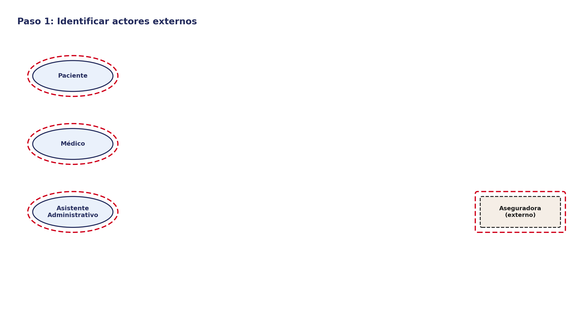

#### Paso 2 — Identificar sistemas internos

Se traza el límite organizacional de la Clínica Salud Viva y se ubican dentro los tres sistemas propios: **Sistema de Agendamiento**, **Notificador (SMS/Email)** y **ERP Clínico**.

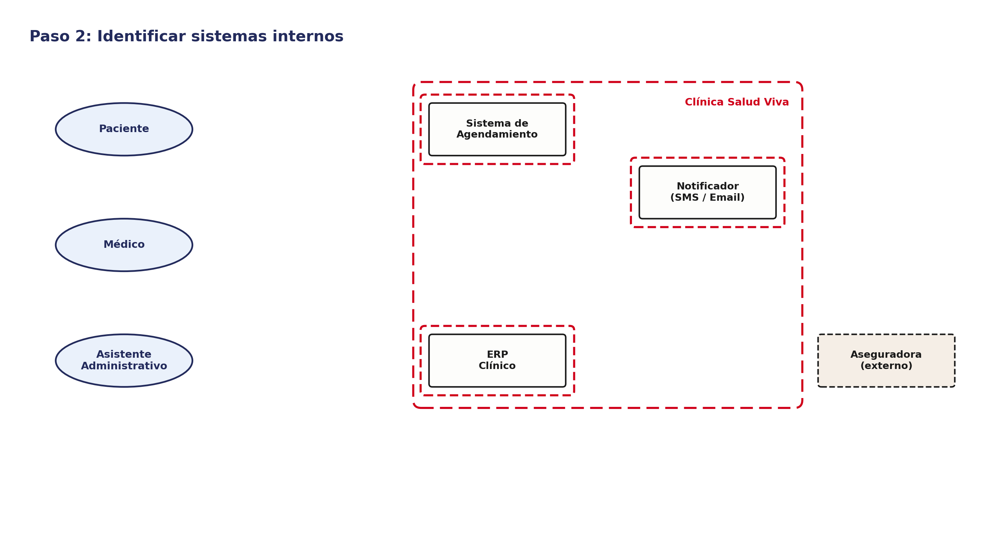

#### Paso 3 — Trazar flujos de información

Se conectan los actores y sistemas externos con los sistemas internos correspondientes, según quién necesita comunicarse con quién.

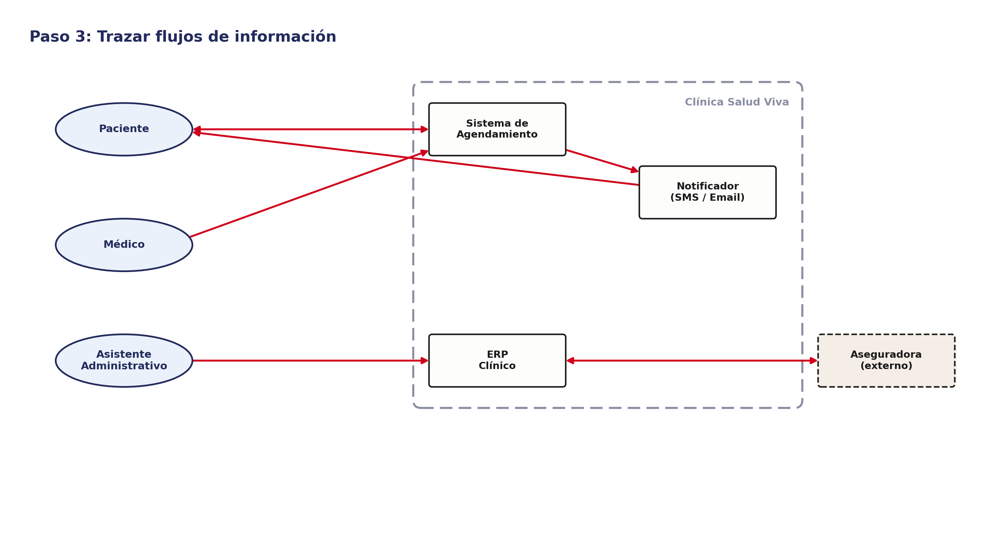

#### Paso 4 — Etiquetar flujos y validar

Se etiqueta cada flujo con la información que transporta (p. ej. "Solicitud / Confirmación de cita", "Validación de cobertura"). Un diagrama de contexto sin etiquetas no comunica nada: la etiqueta es tan importante como la flecha misma.

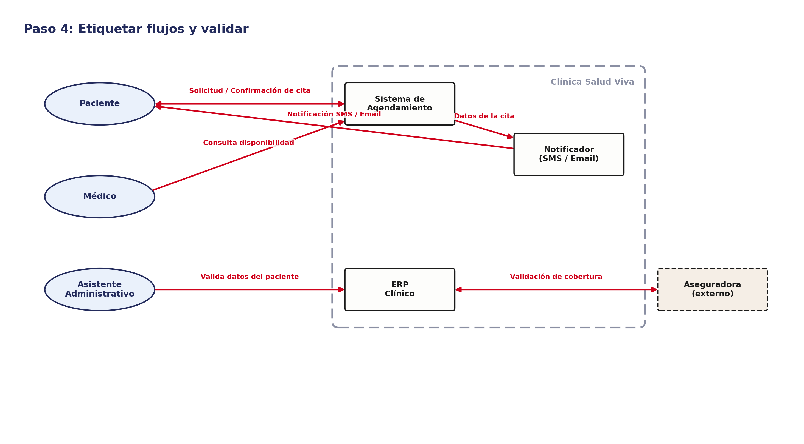

### B.4 Errores comunes en el diagrama de contexto

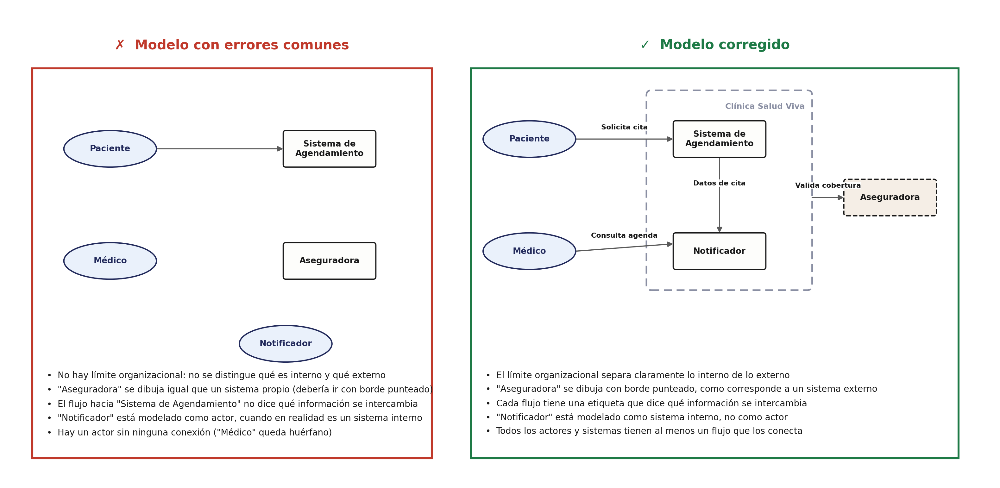

---

## Checklist de autoevaluación antes de entregar

**Modelo ER:**

- [ ] Cada entidad tiene al menos un atributo y una clave primaria (PK) marcada.
- [ ] Toda relación tiene un verbo que la nombra.
- [ ] Toda relación tiene su cardinalidad en ambos extremos (1:1, 1:N o N:N).
- [ ] Las relaciones N:N están resueltas con una entidad asociativa (no se dejan como N:N directas).
- [ ] No hay entidades desconectadas del resto del modelo.

**Diagrama de contexto:**

- [ ] El límite organizacional está dibujado y separa claramente lo interno de lo externo.
- [ ] Los sistemas de terceros se distinguen visualmente de los sistemas propios (borde punteado).
- [ ] Cada flujo tiene una etiqueta que explica qué información se intercambia.
- [ ] Ningún actor ni sistema queda sin al menos una conexión.
- [ ] Los elementos están clasificados correctamente (un sistema no se modela como actor, y viceversa).

---

## Vista ArchiMate equivalente

Este taller alimenta dos capas de ArchiMate a la vez (ver la [Guía de Notación ArchiMate](https://github.com/CesarAVegaF312/AREM-ArchiMate/blob/main/guia_notacion_archimate.md)): las entidades del ERD se convierten en **Data Objects** de la capa de Aplicación, y los sistemas del diagrama de contexto (ERP, Notificador, Sistema de Agendamiento) se convierten en **Application Components**.

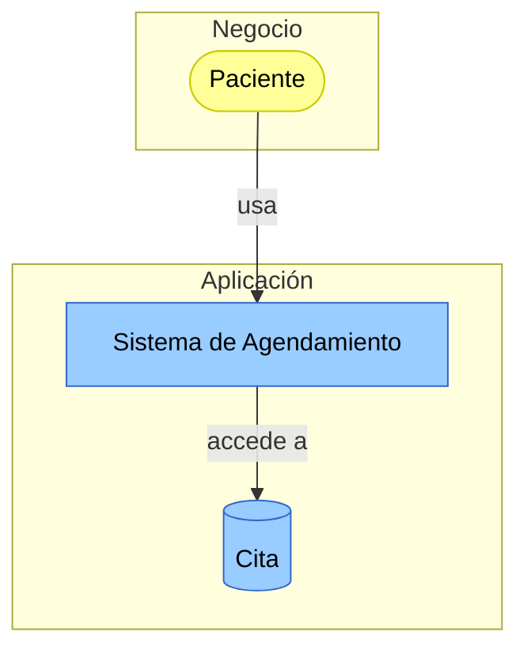

El ERD (`modelo-final-er.drawio`) sigue siendo donde vive el detalle de atributos y cardinalidades; aquí solo se resume la entidad como un Data Object que un Application Component usa — la misma relación **Access** que aparece en el Taller 3 al describir cómo un contenedor del C2 usa una base de datos.

---

## Parte C — Validación técnica del modelo (opcional)

Un ERD puede verse bien en draw.io y aun así no sostener el negocio. Esta parte no es de programación: se trata de **comprobar el modelo**, pasándolo a una base de datos real y haciéndole las preguntas que el cliente le haría. No se escribe código nuevo: los scripts del caso base ya están en [`validacion-tecnica/`](validacion-tecnica/) y solo hay que adaptarlos al modelo del cliente.

### C.1 Qué se necesita

- [Docker Desktop](https://www.docker.com/products/docker-desktop/) (o Docker Engine en Linux).
- Opcional: [DBeaver Community](https://dbeaver.io/), para ver el diagrama que genera la propia base de datos.

### C.2 Correr la validación del caso base

Desde la carpeta `clase/validacion-tecnica/`:

```bash
docker compose up -d
docker compose exec db psql -U clinica -d clinica -f /validacion/03_validacion.sql
docker compose down -v   # al terminar: apaga y borra la base
```

| Archivo | Qué representa del ERD |
|---|---|
| [`01_esquema.sql`](validacion-tecnica/01_esquema.sql) | Cada entidad es una tabla, cada PK un `PRIMARY KEY` y cada relación una `FOREIGN KEY`. La cardinalidad se vuelve regla: `NOT NULL` en la llave foránea dice "obligatorio" y `UNIQUE` convierte un 1:N en 1:1. |
| [`02_datos.sql`](validacion-tecnica/02_datos.sql) | Unos pocos registros de prueba, suficientes para que cada relación tenga ejemplos. |
| [`03_validacion.sql`](validacion-tecnica/03_validacion.sql) | Bloque 1: preguntas del negocio que el modelo debe responder. Bloque 2: operaciones que el ERD prohíbe y que la base de datos debe rechazar. |

El resultado esperado es que el Bloque 1 devuelva datos y que las cuatro instrucciones del Bloque 2 terminen en `ERROR`. Si alguna regla del Bloque 2 **no** falla, el modelo tiene una cardinalidad mal traducida.

### C.3 Qué revela la validación

La validación sirve para encontrar huecos en el modelo, no para demostrar que está perfecto. Por ejemplo, en el caso base:

- **Una pregunta que el modelo no puede responder.** El diagrama de contexto tiene un flujo "Validación de cobertura" con la Aseguradora, pero el ERD no tiene ninguna entidad Aseguradora ni Cobertura. La pregunta "¿qué aseguradora cubre esta cita?" no tiene respuesta en la base de datos. Los dos diagramas no están alineados, y eso no se ve en draw.io.
- **Una regla que no está en el ERD.** Nada impide registrar dos citas del mismo médico a la misma hora. Si el negocio lo prohíbe, falta una restricción, y vale la pena anotarla en el informe aunque no se dibuje en el ERD.

### C.4 Aplicarlo al cliente real

1. Copie la carpeta `validacion-tecnica/` a `entrega/validacion-tecnica/`.
2. Reescriba `01_esquema.sql` con las entidades, atributos y relaciones de su `modelo-final-er.drawio` (una tabla por entidad, una llave foránea por relación).
3. Cargue algunos datos inventados en `02_datos.sql` (nunca datos reales del cliente).
4. En `03_validacion.sql`, escriba 3 preguntas reales del cliente y una regla por cada relación obligatoria o 1:1.
5. Abra la base en DBeaver (servidor `localhost`, puerto `5432`, usuario y clave `clinica`), genere el diagrama ER y compárelo con el de draw.io.
6. En `entrega/informe.md`, anote qué preguntas no pudo responder el modelo y qué cambió en el ERD por eso.

> Si el cliente ya tiene una base de datos, **no** se conecte a ella ni copie datos reales: la validación se hace siempre sobre una base propia, con datos de prueba.

---

## Parte D — Análisis de caso real y panorama tecnológico (opcional)

### D.1 Caso: los casos de COVID-19 que se perdieron en una hoja de cálculo (Inglaterra, 2020)

**Qué pasó.** En octubre de 2020, Public Health England (PHE) informó que 15.841 casos positivos de COVID-19, registrados entre el 25 de septiembre y el 2 de octubre, no se incluyeron en el reporte diario. Los resultados de los laboratorios se cargaban en plantillas de Excel en el formato antiguo XLS, que admite unas 65.000 filas (el formato XLSX admite más de un millón). Cuando un archivo superaba el límite, las filas sobrantes se quedaban por fuera sin ningún aviso. Como esos casos no llegaron a tiempo al sistema de rastreo de contactos (Test and Trace), las personas expuestas se notificaron con días de retraso.

**Qué falló, en el lenguaje de este taller.**

| Elemento | Qué falló |
|---|---|
| Flujo de información (diagrama de contexto) | El flujo Laboratorios → PHE → Test and Trace no tenía control: nadie comparaba cuántos resultados salían de los laboratorios con cuántos llegaban al reporte. |
| Entidad (ERD) | El modelo de "Resultado de prueba" existía en el papel, pero la tecnología donde vivía imponía un límite que el modelo no contemplaba. |
| Regla de negocio | "Todo resultado positivo debe llegar a rastreo" no estaba implementada en ninguna parte: dependía de que el archivo no fuera demasiado grande. |

**Preguntas para el análisis.**

1. ¿En qué punto del diagrama de contexto habría puesto una conciliación de conteos (registros enviados contra registros recibidos)?
2. En la Parte C, la base de datos rechaza lo que el ERD prohíbe y avisa con un `ERROR`. ¿Qué diferencia hay entre una herramienta que rechaza un dato y avisa, y una que lo descarta en silencio?
3. ¿Hay algún flujo del cliente real que hoy dependa de archivos de Excel o CSV enviados entre áreas o entre organizaciones?

**Fuentes.** [The Register, 5 de octubre de 2020](https://www.theregister.com/2020/10/05/test_and_trace/); [The Conversation, "Why you should never use Excel to count coronavirus cases"](https://theconversation.com/why-you-should-never-use-excel-to-count-coronavirus-cases-147681). Las fuentes no coinciden en si el límite que se alcanzó fue de filas o de columnas; lo que sí coincide es que los datos se perdieron sin aviso.

### D.2 Panorama tecnológico: dónde vive el modelo de información

El ERD es independiente de la tecnología, pero la decisión de dónde se guarda cada entidad es una decisión de arquitectura que se justifica en el Taller 7.

| Tipo de tecnología | Ejemplos | Conviene cuando | No conviene cuando |
|---|---|---|---|
| Base de datos relacional | PostgreSQL, MySQL, SQL Server, Oracle | Las entidades tienen relaciones claras y reglas que se deben cumplir siempre (citas, facturas, pagos) | La estructura de los datos cambia de un registro a otro |
| Base de datos documental | MongoDB, Firestore, Couchbase | Cada registro tiene una estructura variable (formularios distintos por especialidad, por ejemplo) | Hay muchas relaciones entre entidades y operaciones que deben ser todo o nada |
| Hoja de cálculo | Excel, Google Sheets | Análisis puntual, prototipos, reportes para personas | Es el sistema de registro o el medio de intercambio entre sistemas (caso PHE) |
| Intercambio entre organizaciones | APIs con esquema publicado (OpenAPI), estándares sectoriales como HL7 FHIR en salud | El flujo cruza el límite organizacional (aseguradoras, entes de control) | Se reemplaza por envío manual de archivos sin validación |
| Herramientas de modelado | draw.io, dbdiagram.io, DBeaver, erwin Data Modeler | Documentar el ERD y, en el caso de DBeaver, generarlo desde una base existente para compararlo | |

### D.3 Aplicarlo al cliente real

1. Busque un caso público y documentado de pérdida, duplicación o mala calidad de datos en el sector del cliente.
2. Analícelo con la [plantilla de análisis de caso](../plantillas/plantilla_analisis_caso.md) y guárdelo en `entrega/analisis-caso.md`.
3. En la sección 5 de la plantilla, compare dos tecnologías del panorama anterior para la entidad más crítica del modelo del cliente.

---

_Esta guía hace parte del Taller 2 de Modelo de Información y Diagrama de Contexto — curso Arquitectura Empresarial, Universidad de La Sabana._
